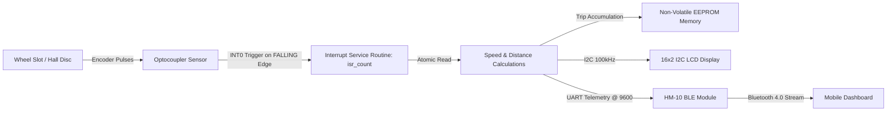
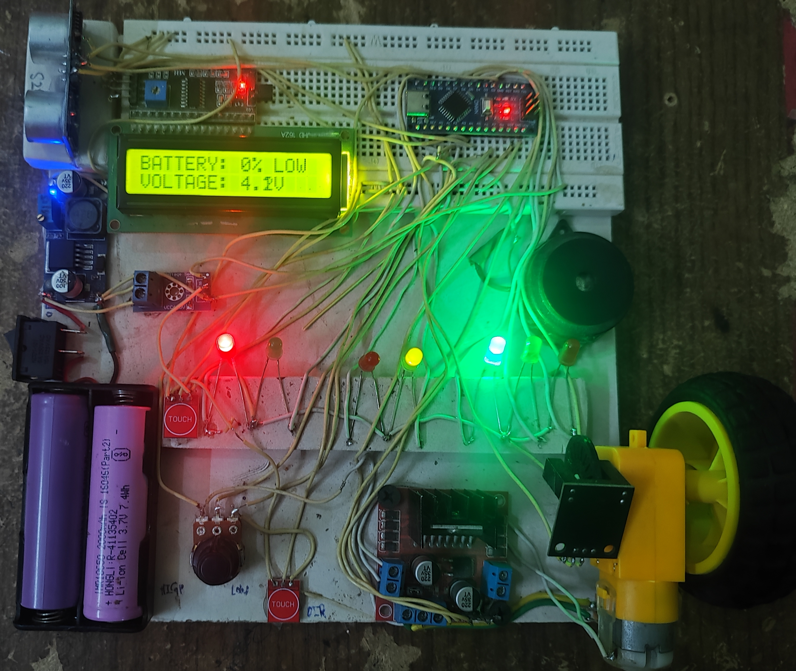
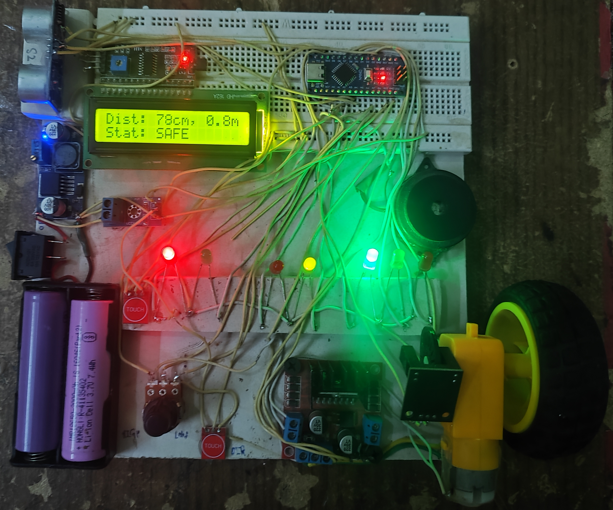

# Automotive Speed & RPM Telemetry System: Hardware Interrupts, Non-Volatile EEPROM Odometer & HM-10 BLE Stream

 

[-00979D.svg?style=for-the-badge&logo=arduino&logoColor=white)](https://www.arduino.cc/)
[-blue.svg?style=for-the-badge)]()

> **Automotive Embedded Instrumentation Project | Graphic Era Hill University (B.Tech ECE 2023–2027)**  
> **Author:** Parth Dalakoti (*President, Robotics & Automation Club, GEHU*)  
> **Contact:** `parthdalakoti482@gmail.com` | [LinkedIn](https://linkedin.com/in/parthdalakoti)

---

## ⚡ Executive Summary

This project implements an **Automotive Speedometer, Tachometer & Non-Volatile Odometer Dashboard**:
1. **Interrupt-Driven RPM Timing:** Employs an optical / Hall-effect slot sensor attached to the wheel axle wired to hardware interrupt pin `INT0 (D2)` on an **ATmega328P**, calculating instantaneous wheel RPM and vehicle linear speed ($v = \omega \cdot r$) with microsecond-level precision.
2. **Wear-Resistant EEPROM Odometer:** Periodically updates vehicle cumulative distance traveled into non-volatile **EEPROM** to persist odometer metrics through power outages without memory degradation.
3. **Dual Telemetry Interface:** Displays speed, trip distance, and engine alerts on a **16x2 I2C LCD** while continuously streaming live telemetry packets over an **HM-10 BLE 4.0** module to a mobile app.

---

## ⚙️ Interrupt Architecture & Signal Flow

---

## 🛠️ Bill of Materials (BOM)

| Component | Part Number / IC | Operating Voltage | Interface | Function |
| :--- | :--- | :--- | :--- | :--- |
| **Microcontroller** | Arduino Nano (ATmega328P) | 5V DC | INT0, I2C, UART | Precision timing, calculation, display |
| **Speed / RPM Sensor** | LM393 Optical Slot / Hall Module | 5V | Digital Interrupt (Pin D2) | Wheel pulse capture |
| **Display Module** | 16x2 Character LCD + PCF8574 | 5V | I2C (Address 0x27) | Instantaneous speed & trip distance |
| **Wireless Module** | HM-10 Bluetooth Low Energy | 3.3V / 5V | UART (SoftwareSerial D11/D12) | Wireless telemetry broadcasting |
| **Motor Driver (Dyno)**| L298N Dual H-Bridge | 5V-12V | PWM + Direction | Wheel dynamometer test motor |

---

## 🔌 Hardware Pinout Table

| Arduino Nano Pin | Peripheral Line | Description |
| :--- | :--- | :--- |
| **D2 (INT0)** | Speed Sensor Digital Out | Hardware interrupt for pulse timing |
| **D5 (PWM)** | L298N Motor ENA | Test rig wheel motor speed control |
| **D6 / D7** | L298N Motor IN1 / IN2 | Motor direction lines |
| **A4 (SDA)** | LCD Display SDA | I2C Data Bus |
| **A5 (SCL)** | LCD Display SCL | I2C Clock Bus |
| **D11 (RX)** | HM-10 BLE TX | Telemetry receive line |
| **D12 (TX)** | HM-10 BLE RX | Telemetry transmit line |

---

## 👨‍💻 Engineering Author
**Parth Dalakoti**  
*B.Tech in Electronics & Communication Engineering (2023–2027)*  
*Graphic Era Hill University (GEHU), Bhimtal Campus*  
*President, Robotics & Automation Club, GEHU*

---

## 📸 Hardware Bench Test Photos

